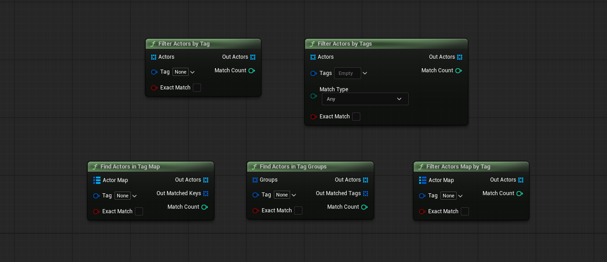

# GameplayTag Filter (Unreal Engine)

Пять Blueprint-нод, которые достают акторы с нужным Gameplay Tag из **массива** или **мапы** одной нодой — вместо связки ForEach → Actor Has Tag → Branch → Add.



**[🇬🇧 English version →](README_EN.md)** · Интерактивная версия с табами: **[README.html](README.html)**

## Совместимость

- Unreal Engine **5.2 и 5.8** (Win64), исходники без версионной специфики
- Один Runtime-модуль; используются стандартные **Actor Tags** (список FName на панели актора), никаких дополнительных систем не нужно

## Сначала о главном: что такое MatchCount

`MatchCount` — это просто **число «сколько нашёл»**, всегда равное длине выходного массива. Он дублирует `OutActors.Num()`, чтобы не тянуть лишний узел: одно сравнение `MatchCount > 0` отвечает на вопрос «нашёлся ли хоть кто-то», удобно выводить его в лог или на экран.

`Gameplay Tag Container` на входе второй ноды — это просто **список тегов** (набор), ничего особенного.

## Ноды — подробно, пин за пином

### 1. Filter Actors by Tag
«У меня есть массив акторов — оставить только тех, у кого есть тег X».

| Пин | Что это |
|---|---|
| `Actors` | Массив акторов, которые проверяем |
| `Tag` | Тег, который ищем |
| `bExactMatch` | `false` (по умолчанию) — с иерархией: запрос `Damage` найдёт и `Damage`, и `Damage.Fire`. `true` — только точное имя |
| `OutActors` | Результат: акторы, у которых тег нашёлся (в том же порядке, что на входе) |
| `MatchCount` | Сколько нашли. Равно длине `OutActors` — для быстрой проверки «нашёлся ли хоть один» |

### 2. Filter Actors by Tags
То же самое, но ищем по **нескольким** тегам сразу.

| Пин | Что это |
|---|---|
| `Actors` | Массив акторов, которые проверяем |
| `Tags` | Список тегов, которые ищем (Gameplay Tag Container) |
| `MatchType` | **Any** — актору достаточно хотя бы одного тега из списка. **All** — нужны все теги из списка |
| `bExactMatch` | Как в первой ноде |
| `OutActors` | Акторы, прошедшие фильтр |
| `MatchCount` | Сколько нашли |

### 3. Find Actors in Tag Map
«У меня мапа, где **ключ — тег**, а **значение — актор**. Достать записи по тегу».

| Пин | Что это |
|---|---|
| `ActorMap` | Сама мапа `Тег → Актoр`. У каждой записи: ключ — тег, значение — актор |
| `Tag` | Тег-запрос. Сравнивается с **ключами** записей |
| `bExactMatch` | `false` — запрос `Damage` находит и запись с ключом `Damage.Fire`; `true` — только точный ключ |
| `OutActors` | Акторы из всех записей, где ключ совпал |
| `OutMatchedKeys` | Какие именно ключи совпали. Полезно при иерархическом поиске: запросили `Status.ChangeFreeze`, а совпал ключ `Status.ChangeFreeze.Grill` — здесь увидишь, какая ветка сработала |
| `MatchCount` | Сколько записей совпало (равно длине `OutActors`) |

### 4. Find Actors in Tag Groups
«Тег → **несколько** акторов». Мапа с массивом внутри в Blueprint запрещена движком (вложенные контейнеры), поэтому такие данные хранятся как **массив структур** `FTaggedActorArray` — у структуры два поля: `Tag` (тег группы) и `Actors` (акторы группы). Нода делает то же, что предыдущая, но возвращает сразу всех акторов подошедших групп.

| Пин | Что это |
|---|---|
| `Groups` | Массив групп. Каждая группа = один тег + акторы, к нему относящиеся |
| `Tag` | Тег-запрос. Сравнивается с тегом каждой группы |
| `bExactMatch` | `false` — запрос `Damage` найдёт и группу с тегом `Damage.Fire`; `true` — только точное имя |
| `OutActors` | Все акторы из всех подошедших групп, слитые в один массив |
| `OutMatchedTags` | Теги именно тех групп, что совпали (каждый — один раз) |
| `MatchCount` | Сколько акторов вернули. Может быть больше числа совпавших групп — в группе обычно несколько акторов |

### 5. Filter Actors Map by Tag
«Мапа, где **ключ — актор**, а **значение — список его тегов**. Отобрать акторов по тегу».

| Пин | Что это |
|---|---|
| `ActorMap` | Сама мапа `Актoр → Теги` |
| `Tag` | Тег-запрос. Проверяется по **списку тегов** (значению) каждой записи |
| `bExactMatch` | Как обычно: `false` — с иерархией, `true` — точно |
| `OutActors` | Акторы-ключи, в списке тегов которых нашёлся запрос |
| `MatchCount` | Сколько нашли |

## Общие правила сравнения

- Записи с пустыми/битыми акторами молча пропускаются; пустой тег-запрос → пустой результат.
- **Иерархия** работает только для тегов, зарегистрированных в словаре проекта (**Project Settings → Gameplay Tags**). Самодельные имена вне словаря совпадают только точно.
- Направление иерархии всегда «от родителя к потомкам»: запрос-родитель находит потомков, но не наоборот.

## Пример

```text
Массив акторов:  Костёр [Damage.Fire]   Лук [Damage]   Дверь [Door]

Filter Actors by Tag (запрос: Damage, bExactMatch = false)
   → Костёр, Лук          (MatchCount = 2)

Filter Actors by Tag (запрос: Damage, bExactMatch = true)
   → Лук                  (MatchCount = 1)
```

## Установка

Скопируйте папку `GameplayTagFilter` в `<Проект>/Plugins/` и перезапустите редактор. Ноды появятся в палитре в категории **Tag Filter**.

## Сборка из исходников

Через UAT (автономная сборка плагина):

```bat
"<Engine>\Engine\Build\BatchFiles\RunUAT.bat" BuildPlugin ^
  "-Plugin=<Path>\GameplayTagFilter.uplugin" "-Package=<OutDir>" -TargetPlatforms=Win64 -NoSubmit
```

Либо как часть проекта: скопируйте папку плагина в `<Проект>/Plugins/` и соберите таргет проекта (`Build.bat <Проект>Editor Win64 Development -project="<Проект>.uproject"`).

> Примечание: в UE 5.x модуль должен содержать явный `IMPLEMENT_MODULE(FDefaultModuleImpl, GameplayTagFilter);` — UHT не всегда генерирует обвязку сам (это уже учтено в исходниках).
